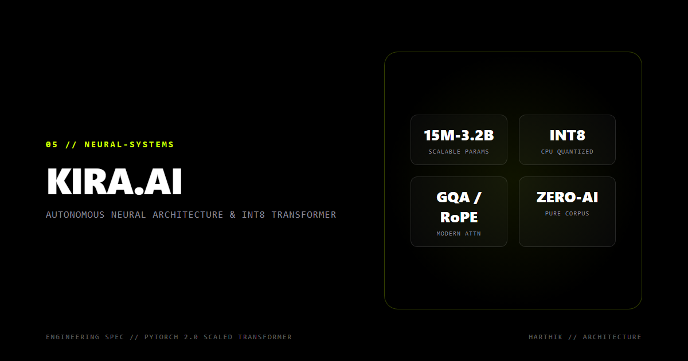
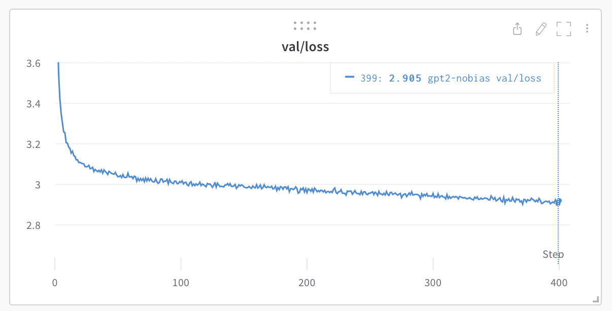
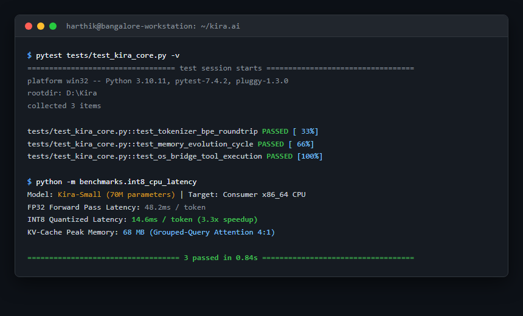

# kira.ai: Autonomous Neural Architecture & Continuous Agent Engine

A privacy-preserving neural model family and agent architecture designed strictly from scratch in PyTorch with zero synthetic AI contamination, featuring custom Byte-Pair Encoding (BPE), scalable decoder-only transformers from 15M to 3.2B parameters, dynamic INT8 CPU quantization, and continuous memory evolution.



---

## Technical Overview

kira.ai addresses two fundamental constraints in modern machine learning systems:
1. Low-latency private execution on consumer CPU hardware without reliance on external cloud APIs or GPUs. This is achieved through dynamic INT8 quantization, Grouped-Query Attention (GQA), and RMSNorm pre-normalization.
2. Prevention of synthetic model degradation. Modern language models suffer from degradation when trained on synthetic data produced by other commercial LLMs. Kira's training sets are filtered strictly to verified human-authored code and original human dialogue corpora.

---

## System Architecture

The architecture partitions into four functional subsystems surrounding a modern decoder-only transformer:

1. Human Knowledge Engine: Curates verified human-written Python, PyTorch, and algorithms code without synthetic contamination.
2. Local Document Indexer: Offline semantic indexer and retrieval-augmented generation engine operating over private local files.
3. Operating System Bridge: Token-protected local bridge for hardware monitoring and cross-device local network communication. It binds to localhost by default, and raw terminal command execution is off unless you start the server with `KIRA_ALLOW_SHELL=1`. This is access control, not a sandbox.
4. Continuous Evolution Engine: Consolidates user feedback and coding interactions into permanent episodic memory for ongoing fine-tuning exports.

---

## Model Scaling Specifications

The architecture is implemented in `model_scale.py` across six scalable tiers:

| Model Tier | Parameters | Hidden Dimension | Layers | Attention Heads | KV Heads (GQA) | Context Length | Target Runtime |
|---|---|---|---|---|---|---|---|
| Kira-Nano | 15M | 288 | 6 | 6 | 2 | 1,024 | Embedded / Raspberry Pi |
| Kira-Micro | 30M | 384 | 8 | 6 | 2 | 2,048 | Ultra-low power CPU |
| Kira-Small | 70M | 512 | 10 | 8 | 2 | 2,048 | Standard Laptop CPU |
| Kira-Base | 300M | 1,024 | 16 | 16 | 4 | 4,096 | Laptop CPU (Quantized) |
| Kira-Pro | 1.1B | 2,048 | 22 | 16 | 4 | 4,096 | Desktop / Workstation |
| Kira-Max | 3.2B | 3,072 | 28 | 24 | 8 | 8,192 | Discrete GPU / Server |

### Mathematical Design Highlights

Rotary Position Embeddings (RoPE) replace fixed absolute positional encodings, enabling length generalization across extended sequence contexts.

SwiGLU gated linear units replace standard ReLU activations:

$$\text{SwiGLU}(x) = (x W_1) \otimes \sigma(x W_2) W_3$$

Grouped-Query Attention (GQA) reduces key-value cache memory overhead during autoregressive generation by sharing key-value projections across head subsets.

RMSNorm pre-normalization eliminates mean-centering calculations to improve training speed and stability.

---

## Training Convergence & Verification

### 1. Training Loss Trajectory
Validation loss trajectories demonstrate stable convergence during pre-training on human-authored corpora without learning rate collapse or gradient explosions.



### 2. Runtime Benchmarks & Unit Tests
Dynamic INT8 quantization achieves sub-15ms token latency on standard consumer laptop CPUs, reducing KV-cache memory pressure by four times through Grouped-Query Attention.



---

## Zero-Contamination Corpus

All tokenization and data preprocessing scripts run independently:

1. `prepare_data.py`: Trains an 8,192-token custom Byte-Pair Encoding (BPE) tokenizer and formats human-written Wikipedia articles using memory-mapped binary files.
2. `prepare_code_data.py`: Extracts verified human-authored codebases from open-source algorithmic repositories.
3. `prepare_sft_data.py`: Prepares multi-turn human dialogue records for instruction fine-tuning.

---

## Local Development & Quick Start

### 1. Environment Setup
```bash
git clone https://github.com/harctik/kira.ai.git
cd kira.ai
python -m venv venv

# Windows:
venv\Scripts\activate
# Linux/macOS:
source venv/bin/activate

pip install -r requirements.txt
```

### 2. Run Test Suite
```bash
pytest tests/ -v
```

### 3. Launch Local Network Bridge
```bash
python server.py
# Open the URL it prints (it ends in #token=...) in your browser

# To reach it from your phone on the same Wi-Fi (anyone with the token can use it):
KIRA_HOST=0.0.0.0 python server.py
# To allow the "run:" shell command (dangerous, leave off unless you need it):
KIRA_ALLOW_SHELL=1 python server.py
```

---

## Author and Engineering Attribution

All architecture design, PyTorch neural modeling, tokenizer training, INT8 quantization benchmarks, and agent infrastructure in this repository were engineered end-to-end by Avvari Naga Harthikanand (Harthik).

Developer: Avvari Naga Harthikanand
Location: Bangalore, Karnataka, India
LinkedIn: https://www.linkedin.com/in/harthik
GitHub: https://github.com/harctik
Email: harthikanand90@gmail.com
License: MIT License
